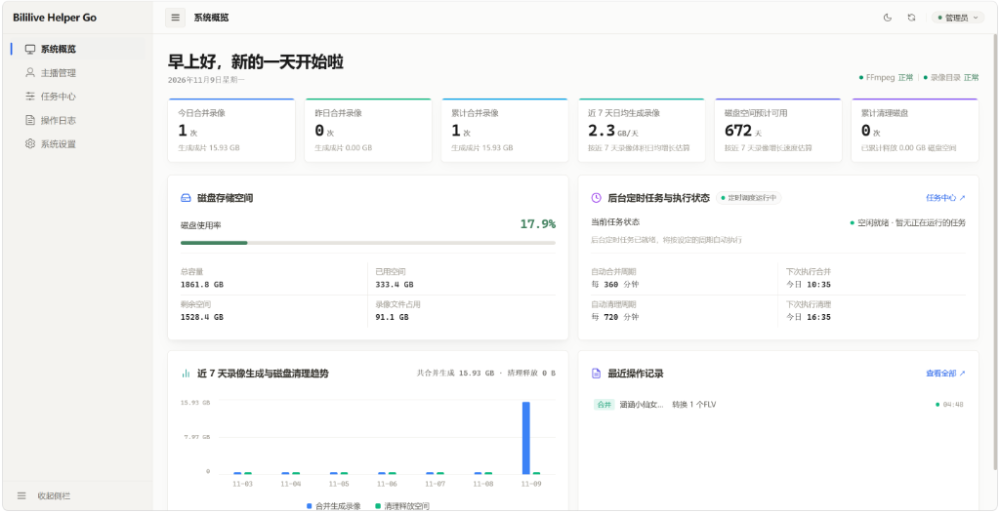

# Bililive Helper Go

> 通用直播录像后处理工具：视频分片合并、磁盘清理、Web 管理控制台。

[](CHANGELOG.md)
[](LICENSE)
[](CHANGELOG.md)

<p align="center">
  <picture>
    <source media="(prefers-color-scheme: dark)" srcset="docs/images/dashboard-dark.png">
    <source media="(prefers-color-scheme: light)" srcset="docs/images/dashboard-light.png">
    
  </picture>
</p>

---

## 功能

- **分片拼接**：监控录像目录，将录制生成的 FLV/TS 分片无损拼接为 MP4，自动对齐重命名关联的 XML 弹幕与封面文件并保留时间戳。
- **磁盘清理**：磁盘使用率达到设定阈值时按天数清理旧录像，级联删除弹幕与封面，支持按主播设置免删保护。
- **主播管理**：支持按主播设置录像时段裁剪与保留规则，支持在网页端直接预览播放录像。
- **控制台**：提供 Web 界面查看磁盘容量、运行实时任务终端、回查操作日志及切换深色模式。
- **环境集成**：镜像内置 FFmpeg，支持 Docker Compose、原生 Docker CLI 与 Windows WSL。

---

## 目录说明

容器内固定使用以下两个标准目录：

| 容器内路径 | 说明 | 宿主机挂载内容 |
| :--- | :--- | :--- |
| `/recordings` | 录像存储目录 | 挂载 bililive-go 等录制工具的输出文件夹 |
| `/data` | 数据存储目录 | 挂载配置文件（config.json）、运行日志与凭据 |

---

## 安装与部署

### 方式一：Docker Compose

1. **克隆项目并配置环境**：
   ```bash
   git clone https://github.com/wuvjie/bililive-helper-go.git
   cd bililive-helper-go
   cp .env.example .env
   ```
   编辑 `.env` 文件，填入实际路径：
   ```env
   RECORDINGS_DIR=/path/to/recordings
   DATA_DIR=/path/to/data
   PORT=5689
   ```

2. **构建并启动**：
   ```bash
   docker compose up -d --build
   ```

---

### 方式二：Docker CLI

直接使用命令行运行容器：

```bash
# 1. 构建镜像
docker build -t bililive-helper-go .

# 2. 运行容器（将 /path/to/... 替换为宿主机实际路径）
docker run -d \
  --name bililive-helper-go \
  --restart always \
  -p 5689:5000 \
  -v /path/to/recordings:/recordings \
  -v /path/to/data:/data \
  -e TARGET_DIR=/recordings \
  -e LOG_DIR=/data \
  -e TZ=Asia/Shanghai \
  bililive-helper-go
```

---

### 方式三：Windows WSL / WSL Container (`wslc`)

在 Windows PowerShell 环境下运行：

```powershell
# 1. 构建镜像
wslc build -t bililive-helper-go .

# 2. 启动容器（将 D:\video\recordings 与 D:\docker\data 替换为实际路径）
wslc run -d `
  --name bililive-helper-go `
  -p 5689:5000 `
  -v D:\video\recordings:/recordings `
  -v D:\docker\bililive-helper-go:/data `
  -e TARGET_DIR=/recordings `
  -e LOG_DIR=/data `
  -e TZ=Asia/Shanghai `
  bililive-helper-go
```

---

## 使用说明

服务启动后，通过浏览器访问：
```text
http://<宿主机IP>:5689
```

- **初始化**：首次启动进入设置向导，设置管理员密码后即可登录。
- **重置密码**：若遗忘密码，删除宿主机数据目录中的 `{DATA_DIR}/.credentials.json` 并重启容器，系统将重新进入设置向导。

---

## 文档

- [更新日志 (CHANGELOG.md)](CHANGELOG.md) — 版本发布与演进记录
- [API 文档 (docs/api.md)](docs/api.md) — REST API 接口定义
- [配置说明 (docs/config.md)](docs/config.md) — 目录与参数配置详解

---

## 致谢

本项目代码主要由 AI 生成与构建，感谢以下大语言模型提供的支持：

> **Gemini** · **MiMo** · **DeepSeek** · **Claude** · **ChatGPT** · **Doubao**

---

## 许可证

本项目基于 [MIT License](LICENSE) 开源。
